# 🛡️ App Control for Business (WDAC) on Windows 11 Enterprise 25H2 — PAW How-To

> [!NOTE]
> **Environment:**  
> &nbsp;&nbsp;• Windows 11 Enterprise 25H2  
> &nbsp;&nbsp;• Windows Server 2025 Core (Domain Controller) <br/>
> &nbsp;&nbsp;• Lab domain `skynet-home.local`  
> &nbsp;&nbsp;• App Control Policy Wizard 2.8.1 (Oct 2026)
> 
> **Primary walkthrough:** One merged single-policy-format policy delivered by the built-in Group Policy setting<br>
> **Primary connectivity profile:** No Internet and no ISG / cloud reputation. PAWs stay domain-joined and receive policy through Group Policy and a UNC share — this is not an air-gapped or fully disconnected deployment.<br>
> **Primary driver:** DISA STIG — two CAT II findings on Privileged Access Workstations (PAWs)  
> **Historical POC XML:** [`poc_policy/WIN11-WDAC-CIPolicy_v10.0.5.1.xml`](poc_policy/WIN11-WDAC-CIPolicy_v10.0.5.1.xml) — retained as the original enforce-mode example, not the latest policy<br>
> **Later policy reviewed:** Version `10.0.5.9`, with ISG, UMCI, and supplemental support enabled; see the profile distinction below. Its binary and authoring XML are not included in this repository.

**Start here:** [Choose merge or supplemental policies](#choose-the-policy-management-model-first) | [Walkthrough](#3--step-by-step-walkthrough) | [Diagnostics](DIAGNOSTICS-README.md) | [Recovery and reset](#recovery-rollback-and-starting-over) | [Step-by-step policy reset](POLICY-RESET-README.md)

---

## 1. 🎯 Why This Matters — The Two STIG CAT II Findings

Before touching the wizard, understand what you are satisfying.

### V-243450 / WPAW-00-001050 — CAT II · Device Guard Code Integrity Policy

> *The Windows PAW must have a WDAC / Code Integrity policy deployed and active to restrict which applications can run on the system.*

**Check (elevated PowerShell):**
```powershell
$IsAdmin = ([Security.Principal.WindowsPrincipal] [Security.Principal.WindowsIdentity]::GetCurrent()).IsInRole([Security.Principal.WindowsBuiltInRole]::Administrator)
if (-not $IsAdmin) { throw "Run the STIG check in an elevated PowerShell session (Run as administrator)." }
Get-CimInstance -ClassName Win32_DeviceGuard -Namespace root\Microsoft\Windows\DeviceGuard | FL *codeintegrity*
```
Run this on the PAW as administrator. The published STIG check requires an elevated session; do not record a result from a non-elevated window. `CodeIntegrityPolicyEnforcementStatus` must be **2** (Enforced). This field reports the effective Code Integrity policy status on the PAW. A value of `1` is Audit and remains a finding.

### V-243451 / WPAW-00-001060 — CAT II · Device Guard User Mode Code Integrity (UMCI)

> *Same requirement as 001050, but specifically verifies that User Mode Code Integrity (UMCI) is enforced — not just kernel mode.*

**Check (same command):**  
`UsermodeCodeIntegrityPolicyEnforcementStatus` must **independently** be **2** (Enforced). This field reports the effective user mode policy status. Enabling `UMCI` in the policy extends App Control checks to user mode executables and scripts, but the XML setting alone does not prove enforcement on a PAW.

These are two separate [DISA PAW V3R3 STIG](https://dl.dod.cyber.mil/wp-content/uploads/stigs/zip/U_MS_Windows_PAW_V3R3_STIG.zip) checks. For **each** field, `0` means Not Configured, `1` means Audit, and `2` means Enforced. The number `2` is a status code, not a requirement to deploy two policies. In Audit mode, applications that would be blocked can still run while App Control logs the event; after removing the Audit Mode option, the policy runs in enforced mode. See [Microsoft's status definitions](https://learn.microsoft.com/en-us/windows/security/hardware-security/enable-virtualization-based-protection-of-code-integrity) and [App Control policy rule options](https://learn.microsoft.com/en-us/windows/security/application-security/application-control/app-control-for-business/design/select-types-of-rules-to-create).

| CI status | UMCI status | STIG result |
|---|---|---|
| `2` | `2` | Both numeric checks met; confirm the active policy allows only approved PAW applications. |
| `2` | `0` or `1` | V-243450 numeric check met; V-243451 remains a finding. |
| `0` or `1` | `2` | V-243450 remains a finding; V-243451 numeric check met. |
| `0` or `1` | `0` or `1` | Both remain findings. |

### How this solution satisfies both findings

| Finding | What is checked | How this policy addresses it |
|---|---|---|
| V-243450 / 001050 | Effective CI policy enforcement | Deploy the policy, confirm it loaded, and verify `CodeIntegrityPolicyEnforcementStatus = 2` on each PAW. |
| V-243451 / 001060 | Effective user mode CI enforcement | Enable UMCI, deploy the policy, and verify `UsermodeCodeIntegrityPolicyEnforcementStatus = 2` on each PAW. |

Both values must return `2` on the target PAW. A policy XML file, GPO link, or Event ID 3099 alone cannot establish that either numeric check is met.

---

## 2. 📋 Pre-Requisites and Environment Assumptions

- **WDAC / App Control Policy Wizard 2.8.1** installed on the admin workstation
- **MECM / ConfigMgr:** Enable Managed Installer only when the deployment agent is designated through the appropriate AppLocker managed-installer configuration and file tagging has been verified. Installing ConfigMgr or enabling the WDAC option alone does not establish trust. Existing applications may need redeployment through the configured installer to acquire origin tags; use explicit rules where appropriate. See [Microsoft's Managed Installer guidance](https://learn.microsoft.com/en-us/windows/security/application-security/application-control/app-control-for-business/design/configure-authorized-apps-deployed-with-a-managed-installer).
- Group Policy infrastructure available (domain-joined PAWs in a dedicated OU — `Workstation` in this lab)
- **No Internet access in the primary profile** → keep **Intelligent Security Graph (ISG) disabled**; do not depend on cloud reputation for authorization. In this guide, "offline" means no Internet, not disconnected from the domain. The walkthrough still requires domain join, Group Policy, and a readable UNC share.
- Windows PowerShell 5.1 with ConfigCI on the authoring workstation; use an elevated session on the target PAW for endpoint diagnostics.
- `CiTool.exe` is built into Windows 11 25H2. `RefreshPolicy.exe` is an optional Microsoft refresh tool; neither replaces verification of activation.
- Admin rights on the PAW being tested
- A known-clean PAW with **only approved software**, a representative approved-workload test plan, and retained audit logs. This is the trust assumption for the audit-driven rule additions in this guide.
- A pilot OU/device, a known-good policy backup, tested recovery access, and BitLocker recovery material before enforcement.

### Choose the Policy Management Model First

**Merging and supplementing are alternatives. Converting events into a policy does not automatically do either.**

| Goal | Allow Supplemental Policies (option 17) | Result and deployment |
|---|---|---|
| Add approved event-derived rules to one existing base | **Not required** | Merge the XML files, compile, and redeploy the updated base. This is the primary GPO walkthrough below. |
| Maintain separately deployed supplemental policies | **Required on the base**, plus correct association/signing | Use the multiple-policy workflow described in [Section 6](#alternative-base-plus-supplemental-policies). The built-in App Control GPO setting does not deploy a multiple-policy set. |

> [!IMPORTANT]
> **Windows 11 and this GPO setting.** Microsoft documents that **Deploy App Control for Business** supports only the single-policy format, and [recommends an alternative deployment method](https://learn.microsoft.com/en-us/windows/security/application-security/application-control/app-control-for-business/deployment/deploy-appcontrol-policies-using-group-policy) — script, ConfigMgr, or the ApplicationControl CSP — on Windows 10 1903 and later and on Windows 11. This walkthrough still uses that setting because the primary policy is one unsigned, single-policy-format file (`SiPolicy.p7b`). Do not use it to deploy a multiple-policy set. New **signed** base policies on systems with memory integrity should be activated with a reboot through the script method. That known issue does not apply to this unsigned primary path, or to an update of a signed base that is already active.

You can enable supplemental support later by updating and redeploying a compatible base. You do **not** need to recreate an audit base merely because option 17 was originally off, and option 17 does **not** need to be enabled just to merge rules.

For the merge path, put the intended base **first in the Wizard's displayed merge table** and the reviewed event-derived policy second. The first input determines the output identity/format; it does not make its allow rules override denies. See [Microsoft's Wizard merge guidance](https://learn.microsoft.com/en-us/windows/security/application-security/application-control/app-control-for-business/design/appcontrol-wizard-merging-policies).

### Historical Offline POC versus the Later 10.0.5.9 Profile

The later artifact reviewed was named `GPO_WDAC_ISG_WSL_DKR_Enforce_SiPolicy_v10.0.5.9_AllowSupplemental_UMCI.p7b`. Inspection of the associated authoring XML and compiled content established these **on-disk settings**, not endpoint activation:

| Setting | Original offline walkthrough / POC | Later `10.0.5.9` artifact |
|---|---|---|
| UMCI | Enabled | Enabled |
| Audit Mode in the final artifact | Absent: enforcement requested | Absent: enforcement requested |
| ISG | Disabled | **Enabled: not the offline profile** |
| Allow Supplemental Policies | Not enabled in the historical POC | Enabled |
| Managed Installer / WHQL | Enabled in the historical POC | Enabled |
| Script enforcement | Disabled | Disabled |
| Boot Audit on Failure | Enabled | Enabled |

The later authoring XML uses legacy `PolicyTypeID` layout. A decoded export containing `PolicyID`/`BasePolicyID` is not by itself proof of a migrated, supported multiple-policy deployment. Its decoded export also failed compilation with the installed ConfigCI schema because of an undeclared `OID` attribute; preserve the editable authoring source rather than assuming a decoded export is a build-ready replacement.

The [Node.js runbook](docs/WDAC-NodeJS-GPO-Runbook.md) records a later lab with a GPO-delivered base and locally registered supplemental policies. Keep that observed lab history distinct from Microsoft's documented built-in GPO limitation and the reproducible primary workflow here. Do not infer current state from filenames or historical screenshots; use the [diagnostics runbook](DIAGNOSTICS-README.md).

---

## 3. 🔨 Step-by-Step Walkthrough

> [!IMPORTANT]
> **`Disabled:Script Enforcement` — Lab Exception, Not a Universal PAW Recommendation**
>
> The supplied POC and later reviewed policy disable script enforcement for lab/admin-tool compatibility. This reduces WDAC script restrictions and requires an explicit risk decision and separate, verified controls over who can launch script hosts. This guide does not configure those user-specific controls. Administrator or SYSTEM identity does not itself exempt a script from App Control.
>
> **Inspect the current PowerShell session:**
> ```powershell
> $ExecutionContext.SessionState.LanguageMode
> ```
>
> This value describes the session, not every script or active policy. See [script enforcement and CLM](#script-enforcement-and-powershell-constrained-language-mode).

**Lifecycle:** Create audit base → deploy and verify → exercise approved workloads → convert events → merge → redeploy in audit → re-test → version and enforce → validate.

Version numbers below are examples continuing beyond `10.0.5.9`. If your deployed version is higher, choose higher versions for every update. Do not deploy an older example over a newer policy. If production is already enforced, perform audit iteration on an isolated pilot; do not downgrade fleet enforcement just to gather events.

### Step 1 — Create the Base Policy in the Wizard (Audit Mode First)

Open the App Control Policy Wizard → **Policy Creator** → choose **Base Policy** and the **Allow Microsoft** template for this walkthrough. Confirm the output remains single-policy format for the built-in GPO path; do not silently convert an existing deployment to multiple-policy format.

**Key decisions on the Policy Rules screen:**

| Rule | Setting | Reason |
|---|---|---|
| Audit Mode | **ON** | Always start here — never enforce an untested policy |
| User Mode Code Integrity (UMCI) | **ON** | Required for WPAW-00-001060 |
| Managed Installer | **ON only if configured and verified** | MECM presence alone is insufficient |
| Allow Supplemental Policies | **Not required for this merge workflow** | Enable only for a planned compatible supplemental workflow |
| Require WHQL | **ON in the supplied policies** | Requires WHQL-signed drivers; inventory and test boot/peripheral drivers |
| Unsigned System Integrity Policy | **ON** | Unsigned policy for initial deployment |
| Update Policy without Rebooting | **ON** | Permits supported future live updates; not a guarantee that every deployment avoids restart |
| Advanced Boot Options Menu | **ON** | Safety net during testing |
| Boot Audit on Failure | **ON during testing** *(Advanced Options)* | Falls back to audit when a boot-critical driver is blocked; not general recovery protection |
| Intelligent Security Graph | **OFF** | No Internet access — ISG will not function |
| Treat Revoked as Unsigned | **OFF in the supplied example; review separately** | Not a general certificate-expiration compatibility switch |
| Disable Script Enforcement | **ON in this lab exception** | Document the reduced script controls and test admin tooling |
| Hypervisor-Protected Code Integrity | **OFF in this policy XML** | HVCI is separately configured and verified in Section 7 |

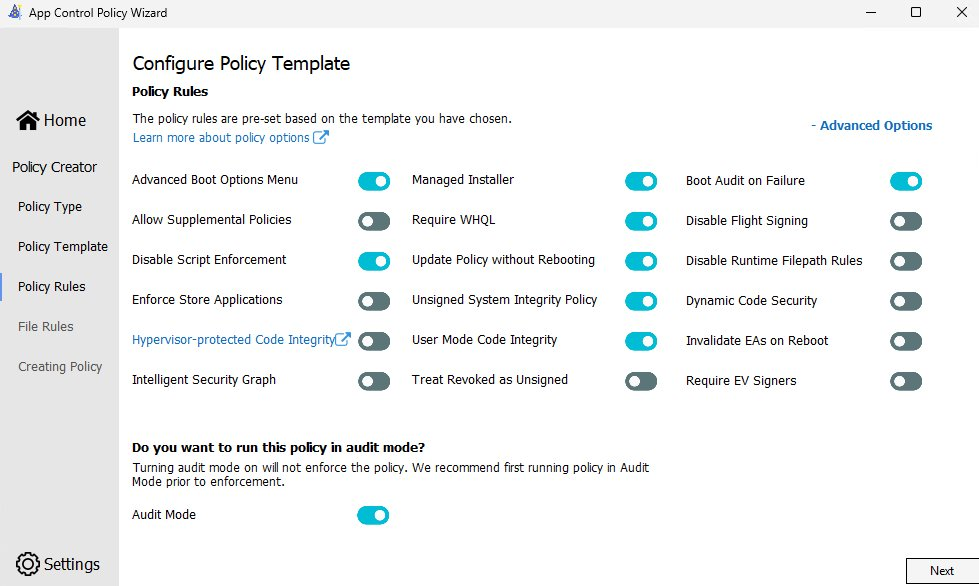

> ⚠️ **Note:** Expand Advanced Options and inspect the saved XML rather than assuming template defaults. Keep **Audit Mode ON** for initial testing. A screen with Audit Mode OFF is already configured for enforcement.

---

### Step 2 — File Rules: Merge the Microsoft Block Lists

On the **File Rules** screen you will see the default Microsoft root publisher allow rules already populated.

At the bottom, check **both**:
- ✅ Merge with Recommended User Mode Block Rules
- ✅ Merge with Recommended Kernel Mode Block Rules

The user-mode list restricts applications Microsoft identifies as potential App Control bypass tools; the kernel-mode list restricts vulnerable drivers. Exact entries and conditions change over time. Review the versions you actually merge and test approved admin tooling, WSL, and Docker where applicable. Do not assume a broad vendor allow will override an explicit deny.

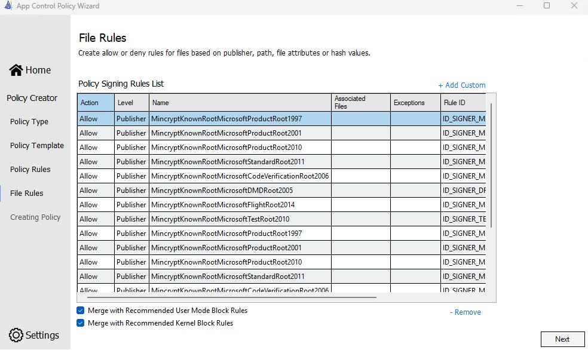

Save the editable XML as `C:\WDAC\Source\Base-Audit.xml` (create your working directories first). Preserve this source and the selected block-list versions. Creating XML in the Wizard does not deploy it to the PAW.

> 💡 **A Microsoft signature is not an unconditional allow.** The Allow Microsoft template provides broad Microsoft trust, but explicit denies and other active policies still apply. Inspect a tool's signature, then validate its actual policy result:
> ```powershell
> Get-AuthenticodeSignature .\Sysmon64.exe | FL SignerCertificate, Status, IsOSBinary
> ```
> `Status = Valid` is useful signature evidence, not proof the tool is authorized by the complete active policy set.

---

### Step 3 — Compile and Deploy the Audit Base through GPO

In Windows PowerShell 5.1 on the authoring workstation, version and compile the source:

```powershell
$BaseXml = 'C:\WDAC\Source\Base-Audit.xml'
$AuditBinary = 'C:\WDAC\Compiled\PAW-Audit.p7b'
Set-CIPolicyVersion -FilePath $BaseXml -Version '10.0.5.10' -ErrorAction Stop
ConvertFrom-CIPolicy -XmlFilePath $BaseXml -BinaryFilePath $AuditBinary -ErrorAction Stop
```

Create the source/compiled directories before running the commands. Publish the binary to your approved deployment share. The example UNC path used here is `\\YourPolicyServer\WDAC$\PAW-Audit.p7b`; replace it with your actual share. Target computer accounts need read access at both share and NTFS levels; only authorized policy administrators should be able to replace the policy.

Configure the pilot GPO. On Windows 11 this built-in setting is the single-policy path Microsoft no longer prefers; it is used here only for one unsigned `SiPolicy.p7b`. See the [deployment note above](#choose-the-policy-management-model-first).

```text
Computer Configuration\Administrative Templates\System\Device Guard
  Deploy App Control for Business = Enabled
  Policy path = \\YourPolicyServer\WDAC$\PAW-Audit.p7b
```

For this **single-policy GPO path**, the deployed endpoint file is `C:\Windows\System32\CodeIntegrity\SiPolicy.p7b`, not a `.p7b` under `CiPolicies\Active`. Multiple-policy deployment instead uses `{PolicyID}.cip` files under `C:\Windows\System32\CodeIntegrity\CiPolicies\Active`.

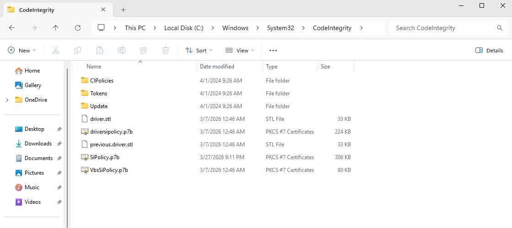

The screenshot shows the historical `SiPolicy.p7b` in the `CodeIntegrity` root. Leave pre-existing Microsoft platform policies such as `driversipolicy.p7b` and `VbsSiPolicy.p7b` alone.

On the pilot PAW, apply GPO from an **elevated** session and inspect computer-scope results. A non-admin `gpupdate /force` can skip computer policy and still exit `0`, so the exit-code check below is not an elevation check:
```powershell
$IsAdmin = ([Security.Principal.WindowsPrincipal] [Security.Principal.WindowsIdentity]::GetCurrent()).IsInRole([Security.Principal.WindowsBuiltInRole]::Administrator)
if (-not $IsAdmin) { throw "Run gpupdate in an elevated session. A non-admin gpupdate can skip computer policy and still exit 0." }
gpupdate /force
if ($LASTEXITCODE -ne 0) { throw "gpupdate failed: $LASTEXITCODE" }
gpresult /r /scope computer
if ($LASTEXITCODE -ne 0) { throw "gpresult failed: $LASTEXITCODE" }
```

**Restart the pilot for the initial built-in GPO deployment**, as documented by Microsoft, then verify the loaded policy in Step 4. A successful elevated `gpupdate` means policy processing completed, not that the intended WDAC binary activated. Supported live updates may use CiTool/RefreshPolicy when applicable, but do not substitute those tools for activation evidence or an explicit reboot requirement. See [Microsoft's GPO deployment procedure](https://learn.microsoft.com/en-us/windows/security/application-security/application-control/app-control-for-business/deployment/deploy-appcontrol-policies-using-group-policy).

---

### Step 4 — Confirm Policy Activation (Event ID 3099) 🔍

On the PAW, query **Microsoft-Windows-CodeIntegrity/Operational** for **3099** and any refresh failures. Filter at the event source before limiting the result count:

```powershell
$Since = (Get-Date).AddHours(-4)
Get-WinEvent -FilterHashtable @{
    LogName = 'Microsoft-Windows-CodeIntegrity/Operational'
    Id = 3095, 3097, 3099, 3100
    StartTime = $Since
} -MaxEvents 20 -ErrorAction Stop |
    Select-Object TimeCreated, Id, Message |
    Format-List
```

The following historical screenshot shows **audit/signature telemetry, not activation evidence**:

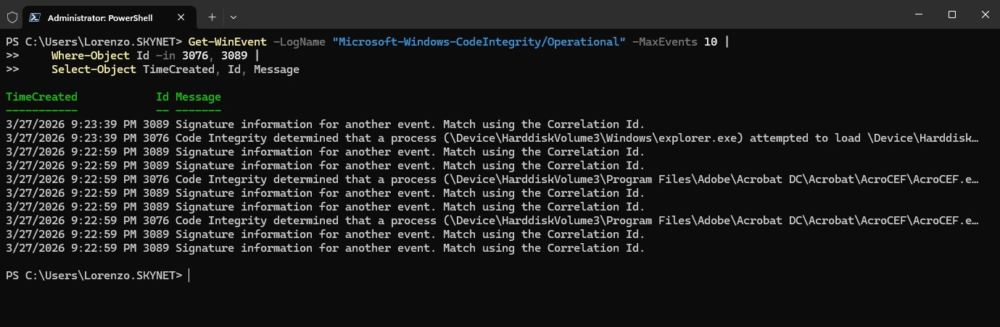

| Event ID | Meaning |
|---|---|
| **3099** ⭐ | Policy loaded; match the intended identity, version, and options in Details/XML |
| **3095** | Refresh requires a reboot |
| **3097 / 3100** | Refresh failed / refreshed policy did not activate successfully |
| **3102** | Policy refresh finished (may show count of active policies) |
| **3103** | Policy refresh ignored (e.g., duplicate or unchanged) |
| **3096** | No change in active CI policy |
| **3076** | Image **would have been blocked** but was allowed due to **audit mode** |
| **3077** | An enforced policy blocked the file |
| **3089** | Signature information associated with another event (use Correlation ID to link) |

Match the intended policy in CiTool inventory and the event details; do not accept another policy's 3099 as proof. Check that audit mode and UMCI are actually configured. See [diagnostics](DIAGNOSTICS-README.md).

After successful activation, record a new test boundary **on the PAW**, then exercise the workloads in Step 5:

```powershell
$AuditRoundStart = Get-Date
$AuditRoundStart.ToString('o')
```

Record this timestamp with the policy version and test results. Keep the session open or restore that recorded timestamp for later queries; do not reset it after the tests.

---

### Step 5 — Collect Audit Telemetry (Event ID 3076)

With the intended policy confirmed active in audit, run the approved PAW test plan: installation/update paths, Adobe, 7-Zip, admin consoles, PowerShell tooling, services, scheduled tasks, and WSL/Docker if approved for this PAW. Cover relevant users and a restart. A 3076 identifies a file that **that policy** would block in enforcement.

**Trust boundary for this lab:** the PAW is known-clean and only approved software is exercised. Its audit feedback is therefore the intended input for approved rule additions. Still confirm the event belongs to this PAW, test window, policy, and workload; that prevents stale/unrelated records from expanding the allowlist accidentally. In less controlled environments, the event alone is not an approval decision.

Open Event Viewer and filter the CodeIntegrity/Operational log to **Event ID 3076**:

```
C:\Windows\System32\mmc.exe eventvwr.msc /c:"Microsoft-Windows-CodeIntegrity/Operational"
```

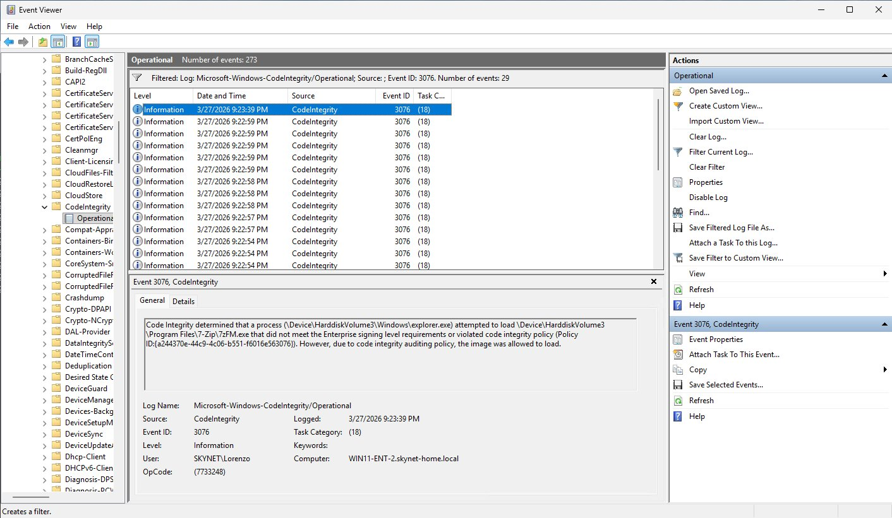

The example above shows `explorer.exe` attempting to load `7-Zip\7zFM.exe` — it was allowed because of audit mode, but the event tells you a rule for 7-Zip is needed before you enforce.

> 💡 **Tip:** The historical filter shows **29 events**, not necessarily 29 applications or 29 unique rules. Events may repeat for executables, DLLs, drivers, or multiple policies. Group by file and policy before deciding coverage.

### Will Old 3076 Events Still Appear after an Update?

**Yes. Deploying a new policy does not erase, relabel, or re-evaluate existing event-log records.** An unrestricted Event Viewer filter or another full-log parse can still show the old entries.

- Fresh runs of files now covered by the updated base should no longer generate new 3076s **from that base**.
- Fresh events can still identify an uncovered component, a changed binary/hash, an explicit deny, an old policy that remained active, or another audit policy.
- Installing a new policy does not automatically rerun every application. No new events is meaningful only after the approved workloads were actually exercised.
- If an independent enforced policy blocks the workload, an additional audit policy does not override that block.

Query only the new round, then inspect policy identity in the event details:

```powershell
Get-WinEvent -FilterHashtable @{
    LogName = 'Microsoft-Windows-CodeIntegrity/Operational'
    Id = 3076
    StartTime = $AuditRoundStart
} -MaxEvents 100 -ErrorAction Stop |
    Select-Object TimeCreated, Id, Message |
    Format-List
```

Preserve historical logs rather than clearing them to simulate a clean round. The [diagnostics runbook](DIAGNOSTICS-README.md#inspect-fresh-audit-events-by-policy) includes a policy-ID-aware query.

---

### Step 6 — Convert Event Logs to Policy Rules

Back in the wizard → **Policy Editor** → **Convert Event Logs to a Policy**.

If the Wizard is running **on the PAW**, select **Parse Event Logs from the system Event Viewer to Policy** and click **Parse Event Logs**. This reads that computer's local `Microsoft-Windows-CodeIntegrity/Operational` and `Microsoft-Windows-AppLocker/MSI and Script` logs.

If the Wizard is on another workstation, export the PAW's relevant logs and use **Parse Event Log evtx Files to Policy** instead. Preserve 3089 signature records along with 3076s; script/MSI audit uses 8028 with 8038 signature information. Parsing local logs on the authoring workstation does not collect PAW events. Export/filter for the intended test window where supported, or exclude older/unrelated candidates during review.

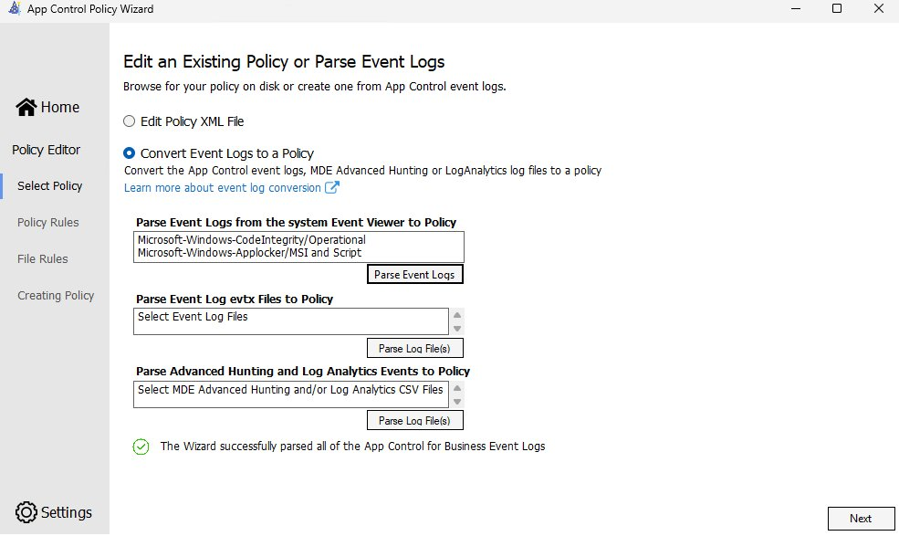

When the wizard presents candidate rules from the parsed 3076 events, you must choose a **rule level** for each one. Picking the right level is the most important decision in this step — too specific and you'll be updating rules constantly; too broad and you lose meaningful control. See [Rule Levels Reference](#rule-levels-available-on-windows-11) below for the full table.

#### 📐 Rule Selection for This Session

Choose the **narrowest maintainable trust scope** appropriate to the approved application; there is no universal broad-to-narrow fallback hierarchy.

- **Signed Adobe or other vendor components:** consider **FilePublisher** for specific approved files and a version floor. Use **Publisher** only when approving the wider publisher's software is intentional.
- **Frequent updates:** FilePublisher can allow later versions of the same signed file. **SignedVersion** is broader: it allows files from that publisher at or above the floor, not just the particular application.
- **7-Zip and unsigned admin utilities:** inspect the actual release's signature. Use a scoped signed rule where available; **Hash** is a valid precise choice for an approved unsigned release, with a planned update process.
- **FileName / standalone File Attributes:** these match resource metadata, not publisher authenticity. Metadata can be imitated; do not treat a stable name as equivalent to a signature.
- **FilePath:** consider only for approved user-mode files in an ACL-verified admin-writable location. Leave runtime path protection enabled; this is unsuitable for user-writable directories and cannot authorize kernel drivers.

> ⚠️ **UX warning:** The wizard does not make undo easy after rules are added. Review each candidate carefully before clicking through.

Save the reviewed event-derived output as `C:\WDAC\Source\Events-Reviewed.xml`. It is a **separate input policy**, not a modification to your base and not automatically a supplemental policy. Retain parser warnings and check for omitted files; log conversion is not a guarantee that every component received a usable rule.

---

### Step 7 — Merge the Base First and Reviewed Event Rules Second

1. Open the Wizard's **Policy Merger**.
2. Select **+ Add Policy** and add `Base-Audit.xml`.
3. Add `Events-Reviewed.xml` second.
4. Verify **Base-Audit.xml is the first row in the displayed table**. Do not rely on a file-picker's selection order.
5. Choose `C:\WDAC\Source\Base-Audit-Merged.xml` as a **new output** and build the merged policy.
6. Open that output in **Policy Editor** and confirm Audit Mode remains ON, UMCI remains ON, intended options are present, and existing deny rules remain.

The first input determines the output type, ID, name, and version information. This is not "first allow rule wins"; denies remain effective. There is no requirement to enable option 17 for this merge.

PowerShell equivalent on the authoring workstation:

```powershell
Merge-CIPolicy -PolicyPaths 'C:\WDAC\Source\Base-Audit.xml','C:\WDAC\Source\Events-Reviewed.xml' `
    -OutputFilePath 'C:\WDAC\Source\Base-Audit-Merged.xml' -ErrorAction Stop
```

Do **not** deploy `Events-Reviewed.xml` as an unrelated enforced base to "add" its rules. Separate enforced bases generally intersect their allowed sets, rather than extending the original base.

---

### Step 8 — Redeploy the Merged Policy in Audit and Run a New Round

Version and compile the merged output, not the old unmerged base:

```powershell
$MergedXml = 'C:\WDAC\Source\Base-Audit-Merged.xml'
Set-CIPolicyVersion -FilePath $MergedXml -Version '10.0.5.11' -ErrorAction Stop
ConvertFrom-CIPolicy -XmlFilePath $MergedXml `
    -BinaryFilePath 'C:\WDAC\Compiled\PAW-Audit.p7b' -ErrorAction Stop
```

Publish the new binary to the pilot GPO's audit source path and repeat Steps 3-4. Confirm the new version actually loaded. Then record a **new** `$AuditRoundStart` and re-run the approved test plan.

Old 3076s remain visible; use the new time boundary and policy identity. Approved files covered by the new rules should stop producing fresh 3076s from this base. Investigate remaining events, revise/merge again as needed, and increment the version for each deployment. Do not declare success merely because no new application was launched.

---

### Step 9 — Prepare the Validated Merged Policy for Enforcement

Copy the validated merged XML to `C:\WDAC\Source\Base-Enforce.xml`, preserving the tested audit source. In **Policy Editor → Edit Policy XML File**, select this copy, set a useful friendly name such as `PAW-Enforce_2026-10-21`, and turn **Audit Mode OFF**.

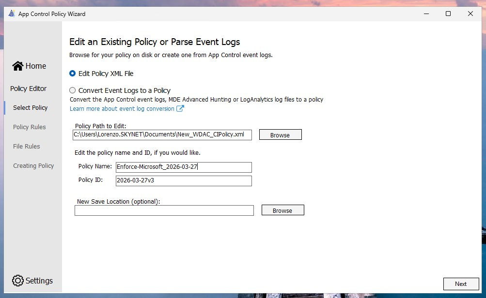

**Identity is not versioning:** the Wizard's friendly PolicyInfo identifier (the date-like `Policy ID` shown in this historical screenshot) is distinct from a multiple-policy GUID and `VersionEx`. Preserve the actual deployed policy identity when updating it. Do not reset GUIDs just to change audit/enforce mode.

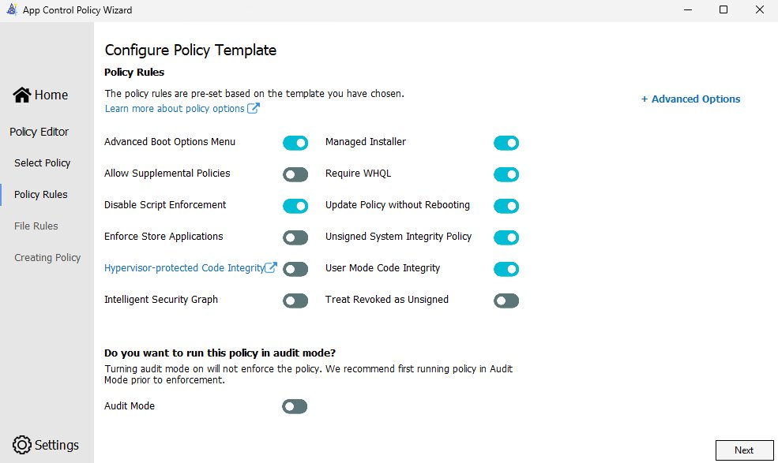

Expand Advanced Options and inspect the saved XML. Do not assume collapsed controls or a filename establish the final settings. Keep required allow rules and approved deny lists; re-import block lists only when intentionally updating them and re-testing their impact.

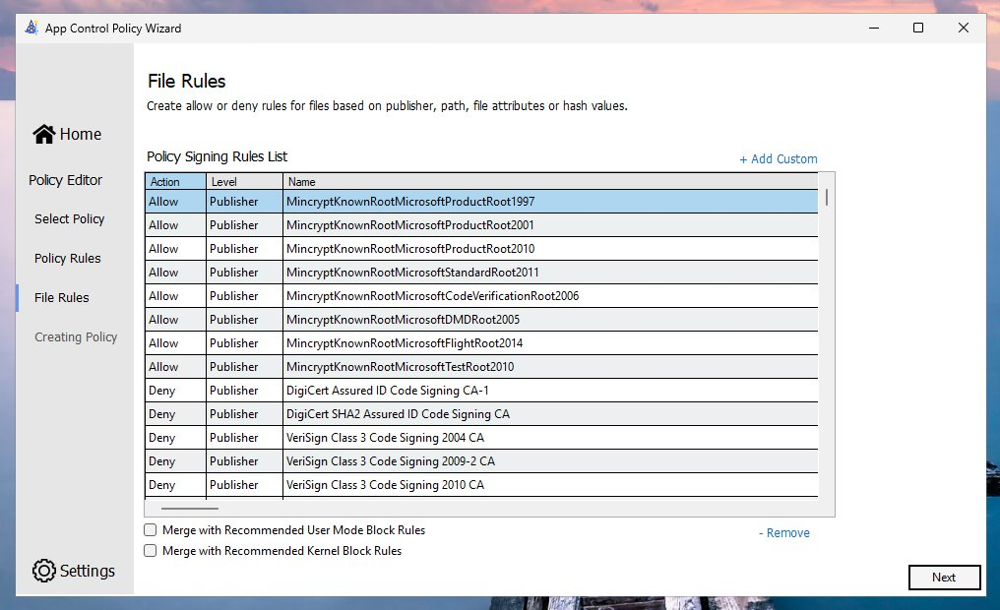

Unchecked block-list merge boxes do not prove entries are absent; rules may already be in the XML. A signer-list label alone also does not prove an entire CA is denied: inspect rule references and file/version constraints.

Compile a forward enforcement revision:

```powershell
$EnforceXml = 'C:\WDAC\Source\Base-Enforce.xml'
Set-CIPolicyVersion -FilePath $EnforceXml -Version '10.0.5.12' -ErrorAction Stop
ConvertFrom-CIPolicy -XmlFilePath $EnforceXml `
    -BinaryFilePath 'C:\WDAC\Compiled\PAW-Enforce.p7b' -ErrorAction Stop
```

Archive the XML, binary, SHA256, version, test results, and rollback source together.

---

### Step 10 — Publish and Deploy the Enforcement Revision to the Pilot

GPO path:
```
Computer Configuration\Administrative Templates\System\Device Guard
→ Deploy App Control for Business → Edit
```

Publish `PAW-Enforce.p7b` to the approved share and point the pilot's effective GPO setting to its UNC path, for example `\\YourPolicyServer\WDAC$\PAW-Enforce.p7b`. In this lab, GPO `GPO_WDAC_Enforcement` is linked to the `Workstation` OU in `skynet-home.local`.

Resolve competing GPO settings deliberately: multiple links do not turn the built-in single-policy deployment setting into additive policy distribution. Confirm the resultant source path on the target.

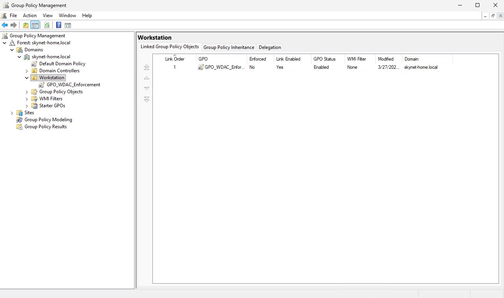

Apply and verify on the PAW from an **elevated** session. A non-admin `gpupdate /force` can skip computer policy and still exit `0`:

```powershell
$IsAdmin = ([Security.Principal.WindowsPrincipal] [Security.Principal.WindowsIdentity]::GetCurrent()).IsInRole([Security.Principal.WindowsBuiltInRole]::Administrator)
if (-not $IsAdmin) { throw "Run gpupdate in an elevated session. A non-admin gpupdate can skip computer policy and still exit 0." }
gpupdate /force
if ($LASTEXITCODE -ne 0) { throw "gpupdate failed: $LASTEXITCODE" }
gpresult /r /scope computer
if ($LASTEXITCODE -ne 0) { throw "gpresult failed: $LASTEXITCODE" }
```

Restart for this reproducible GPO workflow, verify the intended identity/version and absence of Audit Mode in the loaded configuration, then repeat the approved workload tests. Roll out beyond the pilot only after enforcement validation and recovery checks pass.

---

### Step 11 — Validate: Enforcement in Action 🚨

#### App Control block toast

After confirming the intended enforcement revision loaded, first run approved applications and administrative/recovery tools. Then use a controlled negative test: a benign, nonapproved application that you have verified is outside every applicable allow mechanism. The historical example used Firefox:

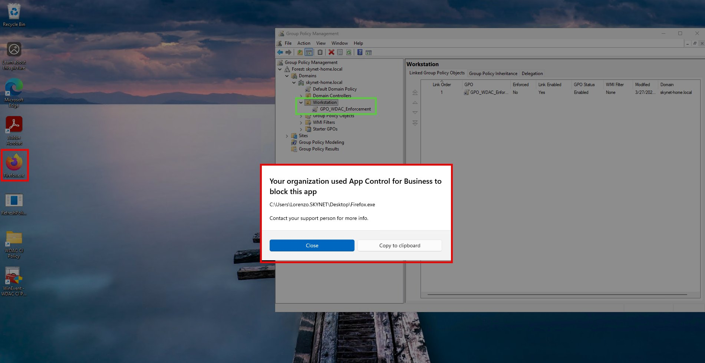

The end-user sees:
> *"Your organization used App Control for Business to block this app"*  
> `C:\Users\Lorenzo.SKYNET\Desktop\Firefox.exe`

#### Event log confirmation

The historical screenshot shows activation context and the user-facing block. Confirm the actual executable block with **3077**, correlated to the file and intended policy; a 3099 is not a block event.

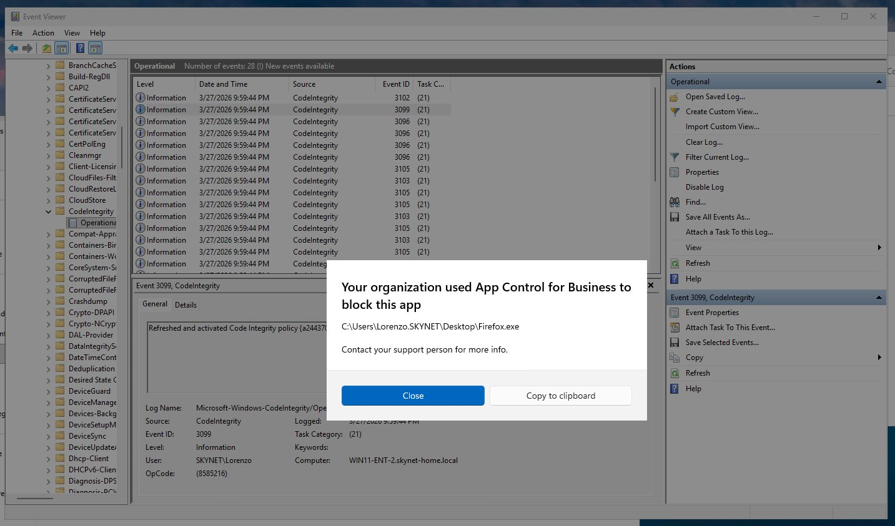

The before/after pattern:
| Mode | What you see |
|---|---|
| **Audit** | Event 3076 — *"would have been blocked... allowed to load"* |
| **Enforce** 🔒 | Event 3077 for the denied file; a toast may appear. Event 3099 separately establishes policy loading. |

In the connected/ISG or Managed Installer profiles, a nominally "unapproved" test file may be authorized by reputation or installation origin. Choose a test consistent with the actual trust model; failure to block that one file does not by itself identify which mechanism allowed it.

---

## 4. ✅ STIG Compliance Verification

With the enforce policy active, run the STIG check from an **elevated** PowerShell session on the PAW. The published check requires Run as administrator; do not record a non-elevated result.

```powershell
$IsAdmin = ([Security.Principal.WindowsPrincipal] [Security.Principal.WindowsIdentity]::GetCurrent()).IsInRole([Security.Principal.WindowsBuiltInRole]::Administrator)
if (-not $IsAdmin) { throw "Run the STIG check in an elevated PowerShell session (Run as administrator)." }
Get-CimInstance -ClassName Win32_DeviceGuard -Namespace root\Microsoft\Windows\DeviceGuard | FL *codeintegrity*
```

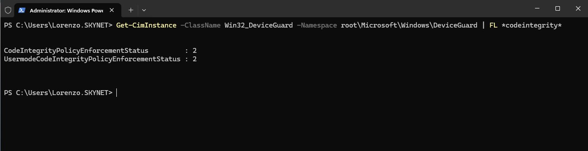

```
CodeIntegrityPolicyEnforcementStatus          : 2
UsermodeCodeIntegrityPolicyEnforcementStatus  : 2
```

| Value | Meaning |
|---|---|
| `2` | ✅ **Enforced** — that field meets its numeric STIG check |
| `1` | ⚠️ Audit only — finding is open |
| `0` | ❌ Not Configured — finding is open |

With both values at `2`, the two numeric STIG checks are met on the tested PAW. Confirm that the loaded policy is the approved PAW allowlist before recording the final assessment.

> For the full finding descriptions and what each check verifies, see [Section 1 — Why This Matters](#1--why-this-matters--the-two-stig-cat-ii-findings).

---

## 5. 📚 Key Reference Material

### Paths and Commands

| Item | Value |
|---|---|
| Single-policy GPO deployment | `C:\Windows\System32\CodeIntegrity\SiPolicy.p7b` |
| Multiple-policy deployment | `C:\Windows\System32\CodeIntegrity\CiPolicies\Active\{PolicyID}.cip` |
| Open CI event log | `C:\Windows\System32\mmc.exe eventvwr.msc /c:"Microsoft-Windows-CodeIntegrity/Operational"` |
| GPO node | `Computer Configuration\Administrative Templates\System\Device Guard\Deploy App Control for Business` |
| Force GPO refresh | Elevated `gpupdate /force`. A non-admin run can skip computer policy and still exit `0`. |
| STIG check | Elevated `Get-CimInstance -ClassName Win32_DeviceGuard -Namespace root\Microsoft\Windows\DeviceGuard \| FL *codeintegrity*` |

For read-only source XML inspection and target PAW checks, see the [Diagnostics and Troubleshooting runbook](DIAGNOSTICS-README.md).

### Event ID Reference

| ID | Meaning |
|---|---|
| 3076 | Would-have-been-blocked (audit mode telemetry) |
| 3077 | File blocked by an enforced policy |
| 3089 | Signature info for a correlated event |
| 3095 | Refresh requires a reboot |
| 3096 | No change in active CI policy |
| 3097 | Policy refresh failed |
| 3099 ⭐ | Policy loaded; correlate identity, version, and options |
| 3100 | Refreshed policy failed activation |
| 3102 | Policy refresh finished |
| 3103 | Policy refresh ignored |
| 3105 | Policy refresh in progress |
| 8028 / 8029 | Script/MSI audit / enforcement decisions in AppLocker MSI and Script |
| 8038 | Correlated script/MSI signature information |

### Rule Levels Available on Windows 11

> Reference: [App Control for Business feature availability — Microsoft Learn](https://learn.microsoft.com/en-us/windows/security/application-security/application-control/app-control-for-business/feature-availability)

| Rule Level | What it matches on | Windows 11 | Best used when |
|---|---|---|---|
| **Publisher** | The code-signing certificate's Issuing CA + the publisher's common name | ✅ | Vendor is well-known and consistently signs their software (e.g., Adobe, Microsoft) |
| **FilePublisher** | Publisher + specific filename + minimum version | ✅ | You want Publisher-level trust but scoped to a specific executable and version floor |
| **SignedVersion** | Publisher + a minimum version number (allows all files from that publisher at or above that version) | ✅ | Vendor ships frequent updates; you want to allow future versions without a policy change |
| **FileName** | The `OriginalFileName` resource attribute by default, not the on-disk name or publisher identity | ✅ | Deliberately approved metadata-based trust; weaker authenticity than signer/hash rules |
| **FilePath** | A specific file system path (user mode only — cannot allow kernel drivers) | ✅ (Win 10 1903+) | Trusted admin-only directories; runtime check enforces the path is not user-writable |
| **Hash** | A cryptographic fingerprint of the approved binary | ✅ | Precise trust for unsigned or fixed-version files; plan rule updates when content changes |
| **PackagedFamilyName** | MSIX/AppX package family name | ✅ | Store apps or MSIX-packaged software |
| **WHQLFilePublisher** | WHQL-certified driver publisher + filename + version | ✅ | Driver allowlisting with version floors |

### Links From the Session

| Resource | URL |
|---|---|
| Deploy App Control via Group Policy | https://learn.microsoft.com/en-us/windows/security/application-security/application-control/app-control-for-business/deployment/deploy-appcontrol-policies-using-group-policy |
| App Control feature availability | https://learn.microsoft.com/en-us/windows/security/application-security/application-control/app-control-for-business/feature-availability |
| Path-based rules | https://learn.microsoft.com/en-us/windows/security/application-security/application-control/app-control-for-business/design/select-types-of-rules-to-create |
| Script Enforcement + PowerShell CLM | https://learn.microsoft.com/en-us/windows/security/application-security/application-control/app-control-for-business/design/script-enforcement |
| Merge policies | https://learn.microsoft.com/en-us/windows/security/application-security/application-control/app-control-for-business/deployment/merge-appcontrol-policies |
| Multiple-policy format and supplemental policies | https://learn.microsoft.com/en-us/windows/security/application-security/application-control/app-control-for-business/design/deploy-multiple-appcontrol-policies |
| Remove policies and signed-policy prerequisites | https://learn.microsoft.com/en-us/windows/security/application-security/application-control/app-control-for-business/deployment/disable-appcontrol-policies |

---

## 6. ⚠️ Caveats, Advanced Options & Policy Rule Recommendations

This section consolidates operational gotchas and Advanced Options panel settings you need to understand before deploying to production.

### Operational Gotchas

- 🔀 **Merge order determines output identity:** Put the intended base first in the displayed table. Reversing inputs can produce the wrong identity/format; it is not inherently XML corruption or first-rule precedence.
- 🖥️ **Windows 11 supports multiple policies:** Separate enforced bases generally intersect their allowlists; a base and its authorized supplementals expand that base's allowed set. Explicit denies still win. The built-in GPO deployment setting remains single-policy only. Microsoft recommends script, ConfigMgr, or CSP deployment on Windows 11; this guide uses the GPO setting only for the unsigned single-policy walkthrough.
- 📡 **No-Internet versus connected profiles:** "Offline" in this guide means no Internet and no ISG, not disconnected from the domain. Disable ISG for that profile. The reviewed `10.0.5.9` variant enables ISG; test connectivity and authorization behavior separately rather than treating cloud reputation as an allowlist when the PAW has no Internet.
- 🥾 **Boot Audit on Failure is limited:** It can switch the policy to audit when a boot-critical driver is blocked. It does not recover every application failure or guarantee both STIG enforcement fields remain `2`.
- 🔧 **Managed Installer requires configuration:** Verify the AppLocker managed-installer designation and file origin tags. Do not use an unspecified registry workaround as a substitute for the documented deployment process.

### Alternative: Base plus Supplemental Policies

Use this route when separate application policies are a management requirement, not because event conversion forces it.

1. Plan a migration to **multiple-policy format** and a supported deployment method: CiTool/script, ConfigMgr, or the ApplicationControl CSP as appropriate. A GPO startup script can deliver the script-based workflow; that is different from the built-in **Deploy App Control for Business** setting.
2. Create/validate a multiple-policy base with a stable unique `PolicyID` and matching `BasePolicyID`. Enable **Allow Supplemental Policies**. For signed bases, configure authorized supplemental signers and sign the supplemental as required.
3. Deploy and verify that base before depending on a supplemental. Do not leave an old restrictive enforced base active accidentally; another base can still block the application.
4. In **Policy Creator → Supplemental Policy**, select the intended compatible base. Add only the reviewed application rules. If using a separate event-derived input, merge it with the intended supplemental first in the merge table, then verify the resulting supplemental identity, base association, options, and rules.
5. A supplemental has its **own** `PolicyID` and a `BasePolicyID` equal to the target base's `PolicyID`. It expands that base; it is not an independently auditable enforcement policy. Audit/UMCI behavior comes from the base; do not put unsupported base-only options in the supplemental.
6. Compile and deploy each binary as `{PolicyID}.cip`, retain forward versions for each identity, and verify authorization and loading on the target. Supplemental allows do not override explicit denies.

For example, after the correctly named binary is prepared, an **intentional deployment action**, not a diagnostic, on a Windows 11 pilot is:

```powershell
& "$env:SystemRoot\System32\CiTool.exe" --update-policy 'C:\WDAC\Compiled\{YOUR-POLICY-GUID}.cip' -json
if ($LASTEXITCODE -ne 0) { throw "CiTool deployment failed: $LASTEXITCODE" }
```

Replace the placeholder with the binary's verified policy GUID. New **signed base** deployments on memory-integrity-enabled systems require a restart under Microsoft's documented deployment caveat; do not assume every CiTool update is rebootless.

See [Microsoft's multiple-policy guidance](https://learn.microsoft.com/en-us/windows/security/application-security/application-control/app-control-for-business/design/deploy-multiple-appcontrol-policies) and [script deployment guidance](https://learn.microsoft.com/en-us/windows/security/application-security/application-control/app-control-for-business/deployment/deploy-appcontrol-policies-with-script). Do not silently reset the identity or rename a `.p7b` to `.cip` and call that a migration.

### Recovery, Rollback, and Starting Over

For the complete removal sequence, signed-base staging, and before/after cleared-state checks, use the [standalone policy reset runbook](POLICY-RESET-README.md). The summary below is not a replacement for its gates.

**Prefer a forward corrective revision to deleting an active policy.** For example, copy known-good rules into a new revision with the **same identity** and a version higher than the deployed version. Going from `10.0.5.9` to `10.0.5.10` is normal; changing the friendly name or date is not versioning. Do not count on a lower-version binary replacing a newer policy.

Before enforcement, retain the editable XML and compiled binary, identities, current version, hash, GPO/source path, signer authorization where applicable, and a tested recovery plan. Confirm the policy permits the tools needed to repair it. Keep recovery access and BitLocker material outside the affected PAW.

**Can you remove `SiPolicy.p7b` and start fresh? Yes, but not by deleting an arbitrary file and assuming enforcement is gone.**

1. Inventory all loaded policies and confirm the exact custom policy ID, version, and actual signing state with CiTool and activation evidence. An XML option allowing unsigned policies is not a substitute for checking whether the deployed artifact is signed.
2. Disable or retarget **every deployment source** for that policy before removal: GPO, startup scripts, ConfigMgr, MDM, or another agent. Otherwise it can return. Allow the updated management settings to reach the target.
3. **Unsigned custom policy:** use the supported policy-specific removal procedure. Windows 11 25H2 supports CiTool removal of unsigned policies without requiring a restart, but verify the result and any remaining copies/deployment sources. A restart remains useful in a controlled reset test.
4. **Signed base policy:** first deploy an authorized **signed replacement** with the same policy ID, an equal-or-higher version, `Enabled:Unsigned System Integrity Policy`, and the required `UpdatePolicySigners`. Sign it with a certificate authorized by the existing policy. **Restart before removal** to deactivate the UEFI protection. Skipping this sequence can cause a boot failure. Signed supplemental removal follows the unsigned-policy removal process.
5. Remove only the verified custom identity. The following is **destructive policy administration**, not a troubleshooting query:

   ```powershell
   & "$env:SystemRoot\System32\CiTool.exe" -rp '{YOUR-VERIFIED-CUSTOM-POLICY-GUID}' -json
   if ($LASTEXITCODE -ne 0) { throw "CiTool policy removal failed: $LASTEXITCODE" }
   ```

6. Re-inventory policies and verify the removed identity is no longer active. If file-based cleanup is required, follow Microsoft's OS/EFI procedure for that exact policy: a legacy policy can have `SiPolicy.p7b` copies in both locations, and corresponding `.cip` files may also exist. **Never delete the entire CodeIntegrity directory or Microsoft platform policies.**
7. For a genuinely fresh design, create and pilot a new audit policy using the deliberately selected deployment model. Re-enable deployment only for that validated artifact. Replacing a policy in place should preserve identity and move the version forward; a new identity is a separate policy, not an update.

The number of past enforcement revisions does not itself prevent a reset. The important state is **what is active now, who can update/remove it, which versions are deployed, and what will redeploy it**. A fully removed policy does not require resetting a friendly version string to `1.0.0.0`; keep an auditable version history. See [Microsoft's removal and boot-recovery procedure](https://learn.microsoft.com/en-us/windows/security/application-security/application-control/app-control-for-business/deployment/disable-appcontrol-policies).

### Script Enforcement and PowerShell Constrained Language Mode

The supplied policies use `Disabled:Script Enforcement` for lab compatibility. Treat this as a documented exception with compensating controls, not proof that script enforcement is unsuitable for every PAW.

**With script enforcement:** script/module trust, not administrator identity, determines Full Language eligibility. Unapproved PowerShell scripts can run in Constrained Language Mode rather than being stopped entirely. Microsoft documents that interactive PowerShell enters CLM when **any UMCI policy is enforced and any active App Control policy enables script enforcement**, even if the latter is in audit mode. To run interactive PowerShell with Full Language rights, script enforcement must be disabled for all applicable App Control policies; other application-control mechanisms can also affect language mode.

**With this option disabled:** App Control's script-enforcement restrictions are reduced, but other policies/controls can still affect behavior, and COM enforcement is separate. This option does not establish a Domain Admin-only PowerShell exemption or prevent standard users from launching PowerShell. Implement and verify any such user-access control separately.

**Verify the active language mode at any time:**
```powershell
$ExecutionContext.SessionState.LanguageMode
```

This is the current session's state, not a definitive inventory of every active enforcement mechanism. Test startup scripts, modules and dependent modules, scheduled tasks, and interactive sessions under their intended accounts. See [Microsoft's script-host behavior](https://learn.microsoft.com/en-us/windows/security/application-security/application-control/app-control-for-business/design/script-enforcement).

### Advanced Options Panel — Setting-by-Setting Analysis

The following settings appear in the wizard's Advanced Options panel or on the main Policy Rules screen. Each has been evaluated specifically for a **disconnected PAW environment** running Windows 11 Enterprise 25H2.

#### Summary

| Setting | Recommendation | Reason |
|---|---|---|
| Treat Revoked as Unsigned | Review explicitly; **OFF in the example** | Changes how affected signatures are treated; not a generic old-certificate exception |
| Disable Runtime Filepath Rules | ✅ Leave **OFF** | Keeping it OFF means the runtime path protection is ON |
| Dynamic Code Security | ⚠️ Leave **OFF** for now | No audit mode — enforce-only, high break risk |
| Invalidate EAs on Reboot | **OFF in the offline profile** | Relevant to ISG; review separately for the connected variant |
| Require EV Signers | Do not depend on it | Microsoft lists the option as unsupported |

---

#### Treat Revoked as Unsigned — Review the Actual Signature Failure

Option 20, `Enabled:Revoked Expired As Unsigned`, treats revoked signatures, and expired signatures with the **Lifetime Signing EKU**, as unsigned under the documented enterprise-signing scenarios. Ordinary expiration, revocation, and invalid trust chains are not interchangeable.

Do not justify leaving it off simply because a government application is old. Inspect 3033/3034 and 3089 signature details. Where an approved exception is necessary, assess whether treating the signature as unsigned plus a precise non-certificate allow rule is appropriate. Retain the example's setting only as an explicit, tested decision. See [policy rule options](https://learn.microsoft.com/en-us/windows/security/application-security/application-control/app-control-for-business/design/select-types-of-rules-to-create) and [signature failure events](https://learn.microsoft.com/en-us/windows/security/application-security/application-control/app-control-for-business/operations/event-id-explanations).

---

#### Disable Runtime Filepath Rules — ✅ Leave OFF

The naming is counterintuitive. Leaving this **OFF** means the protection is **ON** — the runtime check that ensures FilePath rules only apply to admin-writable paths is actively enforced. Enabling this toggle would allow FilePath rules to match user-writable paths, which undermines the security model entirely. Never appropriate on a PAW.

---

#### Dynamic Code Security — ⚠️ Leave OFF for now

Extends WDAC enforcement to .NET assemblies and dynamically loaded code. Valuable in theory on a PAW, but carries a critical operational risk: **there is no audit mode for this setting**. The moment it is enabled it enforces immediately with no warning telemetry to identify what will break. Any .NET-based admin tooling, MMC snap-ins, or PowerShell modules that load dynamic assemblies could stop working instantly. Given the working set already includes Adobe, ADUC snap-ins, and GPO tools, leave this OFF for now. Treat it as a future hardening step requiring dedicated testing in a snapshot/rollback-capable lab environment before being applied to a production PAW.

---

#### Invalidate EAs on Reboot — ✅ Leave OFF

This option causes periodic revalidation of ISG-origin authorization. It has no ISG authorization to revalidate in the offline profile where ISG is disabled. The later `10.0.5.9` artifact enables ISG, so evaluate revalidation and connectivity as part of that distinct profile rather than applying the offline rationale to it.

---

#### Require EV Signers — Unsupported Option

Microsoft currently lists `Required:EV Signers` (option 8) as **not supported**. Do not describe the toggle as an effective all-driver EV requirement or rely on it as a hardening control. **Required:WHQL** is a different option and is enabled in the supplied policies; validate that requirement against actual drivers.

---

## 7. 🖥️ Virtualization Based Security (VBS) & HVCI — Hyper-V Lab Setup

VBS and HVCI complement WDAC and are typically configured as part of PAW hardening. WDAC defines what can run; HVCI strengthens kernel code-integrity enforcement using virtualization-based isolation. These are defense-in-depth controls, not a guarantee against every kernel compromise.

Enabling VBS and HVCI on a Hyper-V guest requires configuration at two layers — the **host** (to expose virtualization extensions to the VM) and the **guest** (to configure and activate the VBS stack via GPO).

---

### On the Hyper-V Host

> [!IMPORTANT]
> The VM must be **shut down** before running these commands. Nested virtualization cannot be enabled on a running VM.

**Step 1 — Expose virtualization extensions to the guest:**
```powershell
Set-VMProcessor -VMName "YourVMName" -ExposeVirtualizationExtensions $true
```

**Step 2 — Use static memory for this nested-virtualization lab:**
```powershell
Set-VMMemory -VMName "YourVMName" -DynamicMemoryEnabled $false
```

**Step 3 — Verify nested virtualization is enabled:**
```powershell
Get-VMProcessor -VMName "YourVMName" | Select-Object ExposeVirtualizationExtensions
# ExposeVirtualizationExtensions : True
```

Boot the VM and proceed with guest configuration.

---

### On the Guest — Enable VBS via Group Policy

**Step 1 — Open Group Policy Editor and navigate to:**
```
Computer Configuration → Administrative Templates → System → Device Guard
→ Turn On Virtualization Based Security → Edit
```

**Step 2 — Set the following options:**

| Setting | Recommended Value |
|---|---|
| Turn On Virtualization Based Security | **Enabled** |
| Select Platform Security Level | **Secure Boot** |
| Virtualization Based Protection of Code Integrity | Enabled without UEFI lock |
| Credential Guard Configuration | Enabled without UEFI lock |

Do not select **Secure Boot and DMA Protection** for this lab. DMA protection is not required for V-243450 or V-243451, and Windows PAW STIG V3R3 has no DMA-protection finding. Those two checks are met when `CodeIntegrityPolicyEnforcementStatus` and `UsermodeCodeIntegrityPolicyEnforcementStatus` are `2`. The guest must actually be using Secure Boot for `RequiredSecurityProperties` to include `2`. That `2` is Secure Boot, not the STIG enforcement status.

> [!IMPORTANT]
> **Evaluate UEFI lock before production deployment.** Firmware-backed configuration resists ordinary remote/OS-level disabling, but the exact protection and removal procedure depend on the feature. Test the supported physical-presence/recovery process and retain BitLocker recovery material. Do not treat a lock as irreversible or proof that every privileged attack is prevented. Lab examples use no UEFI lock to preserve recoverability.

**Step 3 — Apply from an elevated session and reboot:**
```powershell
$IsAdmin = ([Security.Principal.WindowsPrincipal] [Security.Principal.WindowsIdentity]::GetCurrent()).IsInRole([Security.Principal.WindowsBuiltInRole]::Administrator)
if (-not $IsAdmin) { throw "Run gpupdate in an elevated session. A non-admin gpupdate can skip computer policy and still exit 0." }
gpupdate /force
if ($LASTEXITCODE -ne 0) { throw "gpupdate failed: $LASTEXITCODE" }
```
Reboot the guest.

**Step 4 — Verify the posture after reboot from an elevated session:**
```powershell
$IsAdmin = ([Security.Principal.WindowsPrincipal] [Security.Principal.WindowsIdentity]::GetCurrent()).IsInRole([Security.Principal.WindowsBuiltInRole]::Administrator)
if (-not $IsAdmin) { throw "Run this check in an elevated PowerShell session (Run as administrator)." }
Get-CimInstance -ClassName Win32_DeviceGuard -Namespace root\Microsoft\Windows\DeviceGuard | FL *virtualization*, *security*
```

---

### Before / After — Interpret Observed State, Not Just GPO Intent

| Property | Before | After | Meaning |
|---|---|---|---|
| `VirtualizationBasedSecurityStatus` | `2` | `2` | ✅ VBS running at both stages |
| `RequiredSecurityProperties` | `{0}` | `{1, 2}` | Expected for **Secure Boot**: base virtualization support (1) and Secure Boot (2). DMA protection (3) is not selected and is not required. |
| `SecurityServicesConfigured` | `{0}` | `{1, 2}` | ✅ Credential Guard (1) + HVCI (2) configured |
| `SecurityServicesRunning` | `{1}` | `{1, 2}` | ✅ Both Credential Guard (1) and HVCI (2) now running |
| `SecurityFeaturesEnabled` | `{0}` | `{0}` | Do not infer a VBS/HVCI pass from this value alone; use the documented running/configured properties |

These are historical observations, not guaranteed outputs for every VM. `{1, 2}` is the expected `RequiredSecurityProperties` result for **Secure Boot**. It does not include DMA protection (`3`), and this lab does not require that value. V-243450 and V-243451 are satisfied by the Code Integrity and user-mode Code Integrity enforcement fields returning `2`, not by a DMA property.

**Value decode for `SecurityServicesRunning` / `SecurityServicesConfigured`:**
| Value | Service |
|---|---|
| `1` | Credential Guard |
| `2` | HVCI (Hypervisor-Protected Code Integrity) |

**Value decode for `RequiredSecurityProperties`:**
| Value | Property |
|---|---|
| `1` | Base virtualization support |
| `2` | Secure Boot |
| `3` | DMA protection |

---

### What This Posture Provides

**Credential Guard** isolates supported credential secrets using VBS, reducing exposure to credential dumping from the ordinary OS. It does not protect every credential type or prevent every credential-theft technique; administrator credentials remain high-value targets.

**HVCI (Hypervisor-Protected Code Integrity)** uses a VBS-isolated environment for kernel code-integrity checks and enforces restrictions on executable kernel memory. It strengthens the boundary but does not make every signed driver safe; vulnerable-driver controls and driver testing still matter.

Together they form the hardware-backed security baseline that makes a PAW meaningfully resistant to credential theft and kernel-level attacks, not just application-layer controls.

> 💡 **Combined with WDAC:** WDAC restricts authorized code while HVCI strengthens kernel enforcement. Verify both independently rather than treating either one's configured state as proof of the other's operation.

---

### Microsoft Documentation

| Resource | URL |
|---|---|
| Application Control for Business Wizard | https://webapp-wdac-wizard.azurewebsites.net |
| Refresh CI Policy (RefreshPolicy.exe) download | https://www.microsoft.com/en-us/download/details.aspx?id=102925 |
| Virtualization Based Security | https://learn.microsoft.com/en-us/windows-hardware/design/device-experiences/oem-vbs |
| Configure Credential Guard | https://learn.microsoft.com/en-us/windows/security/identity-protection/credential-guard/configure |
| Device Guard hardware property values | https://learn.microsoft.com/en-us/dotnet/api/microsoft.powershell.commands.deviceguardhardwaresecure |

---

## 8. Diagnostics and Troubleshooting

Diagnostics are maintained in the standalone [Diagnostics and Troubleshooting runbook](DIAGNOSTICS-README.md), including source XML inspection, active policy checks, event correlation, and fresh audit queries.

---

## 9. Policy Reset

Use the standalone [Policy Reset runbook](POLICY-RESET-README.md) for step-by-step instructions to identify custom policies, disable their deployment sources, complete signed-base prerequisites where required, remove only the reviewed policies, and verify the cleared state immediately and after restart.
